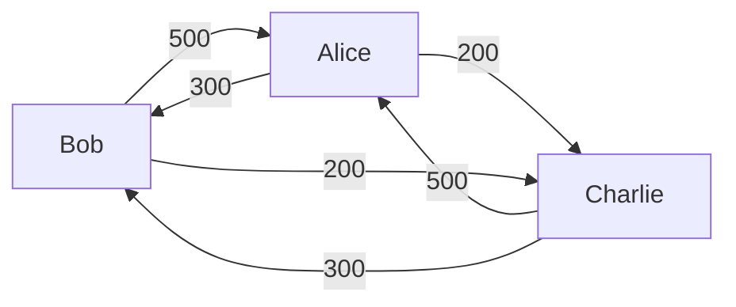
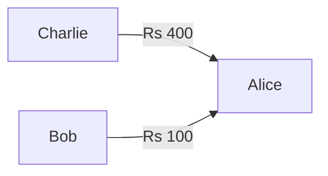
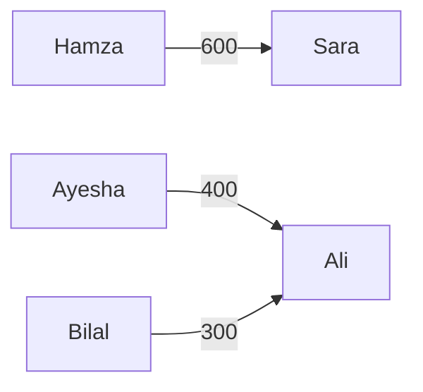

# Splitr: Who Owes Who What

A Next.js + Supabase expense splitter for friend groups, roommates, and trips.
One organizer logs expenses; everyone else gets a read-only share link. No
account required.

🔗 **Live:** https://usesplitr.vercel.app
📸 **Screenshot:** _[embed a hero shot here]_

## Why

Splitwise requires every group member to sign up, which kills adoption in
informal friend circles where only the organizer cares enough to install
anything. This app flips the model: one account for the organizer, name-only
"members", and a unique share link per member for read-only balance views.

## Features

- Multi-group dashboard per user
- Add expenses with equal / exact / percentage splits
- Edit and delete expenses; add, rename and remove members
- Net balance per member
- Settle-up plan that nets everything out (never more than N − 1 payments)
- Unique shareable read-only link per member (copy, send on WhatsApp, or reset)
- Dark / light mode
- Fully responsive, mobile-first (the add-expense form is a bottom sheet on phones)

## Tech

Next.js 15 (App Router) · TypeScript · Tailwind CSS v4 · shadcn/ui
Supabase (Postgres + Auth + RLS) · Vercel · Vitest

## The Settlement Algorithm

> **The question:** after a trip full of shared bills, what's the shortest list
> of "X pays Y" transfers that leaves everyone even?

The code is in [`lib/settle.ts`](lib/settle.ts), about 30 lines plus
comments. Here's how it works.

### 1. The problem

Three friends go to Islamabad for the weekend. Each bill is split equally
three ways:

| Expense | Paid by | Amount | Each person's share |
|---|---|---:|---:|
| Dinner | Alice | Rs 1,500 | Rs 500 |
| Petrol | Bob | Rs 900 | Rs 300 |
| Parking | Charlie | Rs 600 | Rs 200 |

The naive way is to pay back every share to whoever paid it. That's **six
transfers**, and some of them cancel each other out (Alice owes Bob 300 while
Bob owes Alice 500):



### 2. Net everything into one number per person

Who owes whom on which bill doesn't matter. All that matters is each person's
**net balance**:

```
net = (total they paid) − (total of their shares)
```

| | Paid | Shares (500 + 300 + 200) | **Net** | Meaning |
|---|---:|---:|---:|---|
| Alice | 1,500 | 1,000 | **+500** | gets back 500 |
| Bob | 900 | 1,000 | **−100** | owes 100 |
| Charlie | 600 | 1,000 | **−400** | owes 400 |
| **Sum** | | | **0** | |

The balances **always sum to zero**, because every rupee somebody paid is owed
by somebody. `settle()` checks this first and throws if it fails, so a rounding
bug anywhere upstream gets caught here instead of producing a wrong plan.

### 3. Greedy matching: biggest debtor pays biggest creditor

Split people into **creditors** (net > 0) and **debtors** (net < 0); anyone at
zero is already done. Then repeat:

1. Take the debtor who owes the most and the creditor who is owed the most.
2. The debtor pays `min(what they owe, what the creditor is owed)`.
3. Whoever reaches zero leaves their pile.

| Step | Creditors | Debtors | Transfer |
|---|---|---|---|
| start | Alice +500 | Charlie −400, Bob −100 | |
| 1 | Alice +100 | Bob −100 | **Charlie pays Alice 400** |
| 2 | (empty) | (empty) | **Bob pays Alice 100** |

**Six transfers become two:**



The core loop in TypeScript (all amounts are integer paisa):

```ts
while (creditors.length > 0 && debtors.length > 0) {
  creditors.sort((a, b) => b.amount - a.amount || a.memberId.localeCompare(b.memberId));
  debtors.sort((a, b) => a.amount - b.amount || a.memberId.localeCompare(b.memberId));

  const creditor = creditors[0];
  const debtor = debtors[0];
  const payment = Math.min(creditor.amount, -debtor.amount);

  transactions.push({ from: debtor.memberId, to: creditor.memberId, amount: payment });

  creditor.amount -= payment;
  debtor.amount += payment;
  if (creditor.amount === 0) creditors.shift();
  if (debtor.amount === 0) debtors.shift();
}
```

### 4. Why it works

- **It always finishes.** Every transfer takes *at least one* person to exactly
  zero, so the piles keep shrinking.
- **At most N − 1 transfers.** With N people who don't start at zero, each
  transfer removes at least one of them. The last transfer always removes two
  (debtor and creditor hit zero together, because the totals match), so
  there are never more than N − 1 transfers.
- **Everyone ends at exactly zero.** Payments are integers, so nothing is lost
  to rounding.
- **Same input, same plan.** Ties are broken by member ID, so refreshing the
  page never shuffles the plan.
- **Fast enough.** Sorting every round is O(N² log N). N is the size of a
  friend group, so this runs in microseconds; a heap would be premature.

### 5. The honest caveat: greedy is not always optimal

Greedy guarantees **at most N − 1** transfers, but sometimes fewer are possible.
That happens when a smaller subgroup's balances cancel out on their own:

| | Net |
|---|---:|
| Ali | +700 |
| Sara | +600 |
| Hamza | −600 |
| Ayesha | −400 |
| Bilal | −300 |

**Greedy (4 transfers):** Hamza → Ali 600, Ayesha → Sara 400, Bilal → Sara 200,
Bilal → Ali 100.

**Optimal (3 transfers):** Sara and Hamza cancel exactly (+600 / −600), and
Ali's +700 is exactly Ayesha's 400 plus Bilal's 300:



In general the true minimum is **N minus the largest number of groups the
balances can be split into, where each group sums to zero**. Finding that
partition is a subset-sum style problem, which is **NP-hard**. So the trade-off
is deliberate: greedy is simple, instant, provably bounded by N − 1, and for
real friend groups (where balances rarely cancel out exactly) it usually finds
the minimum anyway. An exact solver over all subsets (O(3ᴺ)) would be possible
for small groups. It's on the roadmap, not in v1.

### 6. Tests

[`tests/settle.test.ts`](tests/settle.test.ts) covers:

- the Alice / Bob / Charlie example above (exactly two transfers)
- a 5-person group (≤ 4 transfers)
- everyone already at zero (no transfers)
- two people (always exactly one transfer)
- the caveat example above (greedy takes exactly the 4 transfers shown)
- balances that don't sum to zero (throws)
- input is never mutated, and the output doesn't depend on input order
- **500 random groups** of 2–13 people: every plan settles everyone to exactly
  zero and stays within N − 1 transfers

## Money handling

Every amount is stored and computed as an **integer number of paisa** (1/100
rupee), in `bigint` columns. Rupee strings are parsed digit by digit (never
`parseFloat`), and conversion happens only at input and display.

Splits never lose a paisa: Rs 1.00 split three ways is 33 + 33 + 34. The
leftover paisa go to the payer when they're in the split; otherwise they're
handed out deterministically. The tests check that `sum(shares) === total` for
thousands of random amounts and group sizes, and the database rejects any
expense whose splits don't add up.

## Architecture

```
Browser ──anon key──▶ Supabase (RLS: organizer sees only their own groups)
Server actions ──user session──▶ Supabase (same RLS; atomic writes via RPC)
/share/[token] ──service-role key, server only──▶ hand-shaped, filtered response
```

- **Row Level Security** is on for every table. Policies only grant access to
  the group's owner (`created_by = auth.uid()`). The `anon` role has no table
  privileges at all.
- **Share links** never go through RLS. `lib/share.ts` runs server-side with
  the service-role key, looks the member up by token, and returns only the
  group name, that member's own balance, the expenses they paid for or are part
  of (other people as names only), and the settlement rows involving them.
  It never returns other members' balances, IDs or tokens, or anything about
  the organizer. Share pages are `noindex` and `no-referrer`.
- **Tokens** are 24 random bytes (192 bits) as 32 base64url characters, from
  Node's `crypto`. The organizer can reset any link and the old one stops
  working immediately.
- **Atomic writes:** creating a group with its members, and saving an expense
  with its splits, each happen in a single Postgres function call
  (`create_group`, `save_expense`). Both are `SECURITY INVOKER`, so RLS still
  applies inside them.
- **Integrity triggers** stop an expense from naming a payer or participant
  from a different group, even though the foreign keys alone would allow it.
- **Removing a member** who appears in any expense is blocked. The organizer
  edits or deletes those expenses first, so history is never silently
  rewritten. This is enforced in the app (friendly message) and in the
  database (deferred foreign keys).

The full schema, policies and functions are in
[`supabase/schema.sql`](supabase/schema.sql).

## Run locally

1. **Clone and install**

   ```bash
   git clone https://github.com/HassanAmjad7543/Splitr.git
   cd Splitr
   pnpm install
   ```

2. **Create a Supabase project**, then open the SQL editor and run
   `supabase/schema.sql`.

3. **Configure auth** in the Supabase dashboard:
   - Authentication → URL Configuration: set the Site URL to
     `http://localhost:3000` and add
     `http://localhost:3000/api/auth/callback` to the redirect URLs (add your
     Vercel URL later too).
   - Authentication → Providers → Google: enable it with a Google OAuth client
     ID and secret. The Google client's authorized redirect URI is
     `https://<project-ref>.supabase.co/auth/v1/callback`.

4. **Environment variables**

   ```bash
   cp .env.example .env.local
   ```

   Fill in the project URL, the anon key, and the service-role key (Project
   Settings → API).

5. **Run**

   ```bash
   pnpm dev
   ```

### Tests

```bash
pnpm test        # unit tests: settlement, split math, money parsing
pnpm test:db     # schema + RLS tests against a local Postgres (uses PG* env vars)
pnpm lint
pnpm typecheck
```

`pnpm test:db` creates a throwaway database, loads a small stand-in for
Supabase's `auth` schema, applies `schema.sql`, and checks the following as
two different organizers and as `anon`: data isolation, blocked cross-group
writes, split-sum enforcement, member-delete blocking, and cascading group
deletes.

To check RLS by hand in the Supabase SQL editor:

```sql
set role authenticated;
set request.jwt.claims = '{"sub": "your-test-user-uuid"}';
select * from groups;  -- should return only that user's groups
```

## Deploy (Vercel)

Import the repo in Vercel and set the four variables from `.env.example`
(`NEXT_PUBLIC_SITE_URL` = your production URL). Then add
`https://<your-domain>/api/auth/callback` to the Supabase redirect URLs.

## Project layout

```
app/                 routes: landing, login/signup, groups dashboard + detail, public share page, API routes
components/          UI (shadcn/ui primitives in components/ui)
lib/settle.ts        the settlement algorithm
lib/splits.ts        equal / exact / percentage split math
lib/balances.ts      per-member net balances
lib/money.ts         paisa ⇄ rupee parsing and formatting
lib/share.ts         the share-link privacy boundary (server only)
lib/actions/         server actions (all writes)
lib/supabase/        browser, server, middleware and service-role clients
supabase/schema.sql  tables, RLS policies, triggers, RPC functions
tests/               Vitest unit tests
```

## Roadmap (v1.1)

Exact minimum-transfer solver for small groups, multiple currencies, receipt photos, recurring expenses, "I paid" settle-up
confirmations, payment links (Easypaisa / JazzCash / Raast), CSV export,
co-organizers, Urdu localization.

## Credits

Icons by lucide-react. Auth and database by Supabase.
